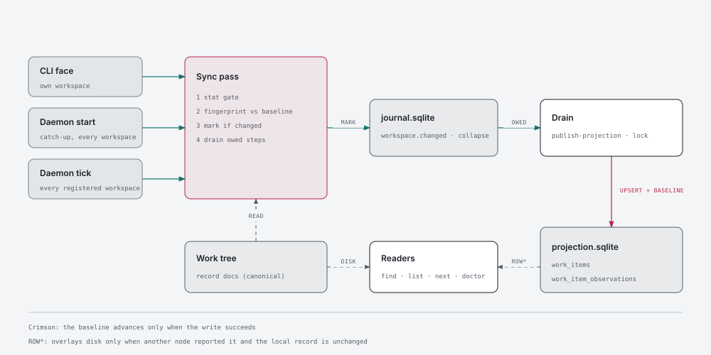

# 164 · Every project change reaches the global store — Architecture Decisions

Recall `16ade46a-85b5-4d85-b705-3ff406c7009c` (architect, `--area architecture`) surfaced m34/ADR-003
(the store is a rebuildable projection) and m05/ADR-001 (a derived index is never a second source of
truth). Both are **honoured**: every decision below keeps the files canonical and the store derived.
It also surfaced m22/ADR-002, m02/ADR-009 and m160/ADR-013, none of which bears on these decisions.

## ADR-001: A node's own record files are canonical in both directions. A local change takes authorship of its row, the assignment lock still decides a held ref, and the store never writes a record doc back to disk

**Status:** Accepted
**Date:** 2026-10-19

**Context.** The operator ruled at framing (2026-10-19) that local files win on reads and on
writes, with one exception: work another machine owns is answered from the store. Three facts
measured in the code shape what "win" means.

- **The store never writes record docs back.** m43 moved worker content into `work_item_docs` and
  `work_item_runs`, and a cache-only item's write doors refuse with `item-not-local` (43/ADR-010).
  No path materialises a stored doc onto a checkout. A worker's work reaches this node's disk only
  by git, when its branch merges home. That answers the framing's open question: nothing in m43
  contradicts "files win", so no write-back has to be retired.
- **The write rule today is authorship.** `upsertWorkItems` (`packages/mesh/src/projection-store.mjs:570`)
  lets a `disk-derived` publish refresh only rows this node authored. It steps over a row another
  node authored (`authored-elsewhere`, `:677`), and that skip lasts forever unless an operator verb
  names the ref (`operatorRefs`, ADR-010/D1). So a hand edit, `git pull` or scaffold that touches a
  ref a worker last reported never reaches the store, even when a publish does run.
- **The lock** (43/ADR-003) refuses a write to a ref whose execution scope an assignment holds,
  from anyone but the holder.

**Decision.**
- A ref whose local record has **changed since this node last observed it** (ADR-002) takes
  authorship in the next publish of its workspace. The publish passes these refs as
  `localChangeRefs`, beside `operatorRefs` and with the same effect at the authorship step. A
  local edit is an operator act that happens not to go through a verb.
- **The lock is not bypassed.** While another node holds a ref's scope, the changed ref is
  skipped as `held-by-assignment`, exactly as today. Its baseline does **not** advance (ADR-002),
  so the change stays owed. What happens once the lock releases is the rule in story 00's example
  map (question Q1): the person decides it, and it is not defaulted here.
- A ref with **no** local change keeps today's `disk-derived` discipline: it refreshes its own
  rows and steps over every other node's. That is what stops a stale local scaffold from
  reverting a worker's report (the m43 disease).
- No code path writes a stored row or doc onto a checkout. Records reach a disk by the operator's
  hand, a verb, or git.

**Alternatives considered.**
- *Every disk-derived publish takes authorship.* Rejected: it reintroduces the m43 revert. The
  control's stale scaffold of a worker-authored item would overwrite the worker's report on every
  tick.
- *Compare timestamps across nodes.* Rejected, as 43/ADR-010/D1 rejected it: clock skew decides
  the outcome.

**Consequences.** A hand edit and a verb mutation now reach the store by the same door. `git pull`
of a merged worker branch changes the local record, so the control takes the row back as soon as
the merged state lands on its disk. That is right, because the merged files are now canonical.

**Invariant.** A record-doc write only happens on the operator's or git's side of the boundary. No
store-to-disk materialiser exists. This is enforced by FF-16404.

---

## ADR-002: "Changed since observed" has ONE home: a per-ref fingerprint baseline that only a successful write advances, where a missing baseline is never a change

**Status:** Accepted
**Date:** 2026-10-19

**Context.** ADR-001's write rule and ADR-005's read rule both need to ask one question: has this
node's record for this ref changed since this node last saw it? File mtimes cannot answer it,
because `git checkout` and `git pull` rewrite them without changing content. Today's journal
records verb events, not file states, so it cannot answer either.

**Decision.**
- The **fingerprint** of a ref is a stable hash of the projected row as derived from local disk:
  the fields `readWorkspaceProjectionItems` already produces (type, slug, status, title, parent,
  source path, backlog, archived). Prose edits that change no row field are not changes. The row
  is all the store carries.
- The **baseline** is a node-local table in the projection store,
  `work_item_observations(workspace_id, ref, node_id, fingerprint, observed_at)`. It is classified
  in `packages/mesh/src/store-metadata.mjs` with `projection-store.mjs` as its only writer.
- **Only a successful write advances the baseline.** In one transaction with the upsert, every
  ref the publish wrote, and every ref it stepped over because another node authored it with no
  local change, records its current fingerprint. A ref skipped by the lock, or a publish that
  failed, records nothing, so the change stays owed and the next pass finds it again. Nothing
  else (ledger state, retry counts) has to be right for a change to eventually land.
- **A missing baseline is never a change.** On a new store, a rebuilt store or a never-seen ref,
  the first pass records the baseline and claims no authorship. A lost table therefore costs one
  quiet re-baseline, never a wave of stale scaffolds taking over worker rows.
- **Stat-level gate.** Before hashing rows, the detector compares a workspace digest of
  `(path, size, mtimeMs)` over the work tree's record docs with the digest it last stored. An
  equal digest skips the row pass. This digest only decides whether to look. The decision itself
  is always the fingerprint comparison.
- The comparison is one exported predicate. The publisher (ADR-001), the detector (ADR-004) and
  the read rule (ADR-005) all call it. This is enforced by FF-16401.
- **Its home is a new pure leaf, `packages/work/src/local-change.mjs`:** `rowFingerprint(row)`
  and `locallyChanged(fingerprint, baseline)`, with no imports. `@aof/mesh` already depends on
  `@aof/work`, and both readers (`read.mjs`, `doctor/`) live in work, so work is the only
  package all three users can import without a new edge. The baseline table and its reads and
  writes stay in `projection-store.mjs`, the store's single writer.
- The baseline table bumps `GLOBAL_WORK_SCHEMA_VERSION` 10 → 11 through the existing guarded
  `CREATE TABLE IF NOT EXISTS` migration.

**Alternatives considered.**
- *git HEAD plus dirty state as the change signal.* Rejected as the decision. A workspace that is
  not a git checkout, and an uncommitted hand edit, both have to work. It stays acceptable as an
  extra input to the gate.
- *Fingerprint the record-doc bytes.* Rejected: any prose edit would steal authorship of a row
  whose fields never changed.

**Consequences.** The baseline is bookkeeping, not truth. It can be dropped and rebuilt, so m34's
rebuild path still holds. Every reader of the predicate has to have the baseline in hand, which
ADR-005 handles on the read side.

---

## ADR-003: Sync marks ride the EXISTING effects journal as a `workspace.changed` event. The journal gains a generic collapse key, and no sibling ledger store is added

**Status:** Accepted
**Date:** 2026-10-19

**Context.** The operator proposed a global ledger that every project writes to and one service
drains. `~/.aof/mesh/work/journal.sqlite` already is one: global, append-only `events` plus owed
`effect_steps`, drained by `drainEffects` (`packages/effects/src/dispatch.mjs`). Publish-on-mutate
already rides it (`publish-projection`, `packages/mesh/src/effects.mjs:162-182`). What it lacks is
an entry for changes no verb raised, and a way to keep N owed publishes of one workspace from
running N times. The operator's standing rule is to extend the existing surface, never add a
sibling (memory: extend-existing-surfaces).

**Decision.**
- A new event, `workspace.changed`, with payload `{ workspaceRoot, workspaceId, digest }`, maps to
  the existing `publish-projection` reactor (locus `local`). Its apply already loads the workspace
  from `workspaceRoot` and publishes. Under ADR-001 that publish now also carries the
  `localChangeRefs` it computes.
- **Idempotent append.** The event id is derived from `(workspaceId, digest)`. Re-observing the
  same state is an `INSERT OR IGNORE` no-op through the existing `appendEvent`.
- **Collapse.** `events` gains a nullable `collapse_key` column (journal schema v2, through
  `migrateSchema`). When `appendEvent` writes an event that carries a collapse key, it settles
  every still-owed step of older events with the same key as `superseded`, in the same
  transaction. `superseded` joins `STEP_STATUSES`. The journal stays vocabulary-blind: it compares
  an opaque key and never knows what a workspace is. `workspace.changed` uses `ws:<workspaceId>`.
  The verb events keep no collapse key, so they behave exactly as today.
- **No new store.** Sync state lives in two existing SQLite files: `journal.sqlite` (owed work)
  and `projection.sqlite` (rows plus baseline). This is enforced by FF-16403.

**Alternatives considered.**
- *A new append-only `ledger.jsonl` per node, drained by the daemon.* Rejected: it would be a
  second ledger beside the journal, with its own durability, retry and observability, and two
  places to look when a change goes missing.
- *Record per-file change events.* Rejected: publishing is state-based (it re-reads the whole
  workspace), so "workspace X changed" carries everything a drain needs. Per-file entries would
  only add replay ordering that nothing uses.

**Consequences.** Every owed sync is visible through the same journal reads `aof work doctor`
already uses for effects. A daemon that has been down for a day finds at most one owed mark per
workspace, not a backlog.

---

## ADR-004: ONE sync pass (detect, mark, drain) with three drivers: the daemon tick over every registered workspace, the daemon start as catch-up, and every CLI command for its own workspace

**Status:** Accepted
**Date:** 2026-10-19

**Context.** Measured at framing:
- The daemon's propagation tick publishes only `ws`, the workspace loaded from the daemon's own
  cwd (`packages/mesh/src/commands/serve.mjs:41`, `packages/mesh/src/launcher.mjs:787-793`).
- The desktop supervisor starts `mesh serve` with no cwd
  (`apps/desktop/crates/core/src/supervision.rs:51-57`), so that publish is refused as
  `mesh-workspace-unconfigured`. No daemon pass ever re-reads a project.
- The presence tick already enumerates this node's registered workspaces
  (`resolveAggregationWorkspaces`, `launcher.mjs:312`, over `resolveNodeWorkspaces`,
  `packages/mesh/src/presence.mjs:294`), so the set exists. The propagation tick just never
  uses it.
- With no daemon running, owed steps drain only when a later CLI command's `sweepPendingEffects`
  runs (`packages/core/src/application/bindings/spine/face.mjs:304`).

**Decision.**
- **One pass, `syncWorkspace(workspace)`:** run the stat gate, then the fingerprint comparison
  (ADR-002), then append `workspace.changed` (ADR-003) when anything changed, then drain that
  workspace's owed local-locus steps. It lives behind the publisher seam
  (`acd-global-publisher-single-seam`) and opens the store only through an existing opener. That
  is TECH_DEBT item 12's ratchet: no twentieth opener.
- **Driver 1, the daemon tick.** Every propagation tick runs the pass over
  `resolveAggregationWorkspaces`: the registered set plus the launch cwd when that cwd is a real
  workspace, sharing the tick's one store handle. The cwd-only `publishGlobalWorkSnapshot(ws)` in
  `capturePropagation` is replaced, not kept beside it. A registered workspace whose folder is
  gone is skipped and reported (the existing loud-skip shape), never silently dropped.
- **Driver 2, the daemon start.** `startLauncher` runs the same pass over the same set before the
  first tick. A change made while the desktop app was off (a `git pull`, a hand edit, a scaffold)
  lands on start.
- **Driver 3, the CLI face.** Before `sweepPendingEffects` drains, it runs the pass for the
  command's own workspace only, when that workspace is mesh-propagating
  (`meshGlobalPropagationDecision`). With no daemon at all, the next `aof` command in a project
  still syncs that project. Other workspaces wait for the daemon, or for a command run in them.
- The publish decision is unchanged. A workspace propagates only under `mesh.enabled` or
  `mesh.repo.published`, with its own config, and never as a lane (`publisher.mjs:33-87`).

**Alternatives considered.**
- *A file watcher.* Rejected: it misses changes made while nothing runs (the very case at issue),
  and adds a long-lived OS resource per workspace. The startup and CLI drivers already cover what
  a watcher would.
- *A new `aof mesh sync` verb as the offline path.* Not needed for propagation, since driver 3
  covers it. Whether the operator wants a manual door to see or force sync is story 03's question.

**Consequences.** Of TECH_DEBT item 4, "daemons publish system32 / `~/.aof/bin`" stops mattering
for propagation: the tick addresses workspaces by descriptor, not cwd. The identity half of item 4
stays out of scope. Each CLI command pays one stat walk of its own work tree, the same order of
cost as the `listItems` it already does.

### Diagram

**Why.** Three drivers, two stores and one gate meet in this decision. The reader has to see that
every path into the store goes through the same pass, and that only a successful write advances
the baseline.

**View.** A data-flow diagram, left to right.

**Components.** The project work tree (record docs). The three drivers: the CLI face, the daemon
start and the daemon tick. The sync pass, made of the stat gate, the fingerprint compare and the
mark. `journal.sqlite` (`workspace.changed`, collapse key). The drain (`publish-projection`, under
the lock and authorship rules). `projection.sqlite` (`work_items` plus the
`work_item_observations` baseline). The readers (`find`/`list`/`next`, doctor).

**Flows.**
- Each driver calls the pass. The pass reads the work tree and appends a mark to the journal.
- The drain reads owed marks and upserts rows.
- Only on success does the baseline advance. A failure or a lock skip leaves the change owed.
- The readers read the disk and the store, and the cache overlays only a row another node
  reported for a ref with no local change.

Source: [ADR-004-one-sync-pass.html](diagrams/ADR-004-one-sync-pass.html) · PNG: [ADR-004-one-sync-pass.png](diagrams/ADR-004-one-sync-pass.png)

---

## ADR-005: Reads answer a node's own records from its files. A cached row overlays a local record ONLY when another node reported it and the local record has not changed since observed. Narrows 43/ADR-005's "the cache's row wins, whoever reported it"

**Status:** Accepted
**Date:** 2026-10-19

**Context.** `buildStreamView` (`packages/work/src/read.mjs:196-260`) overlays every cached row's
`status` and `title` onto the local item (`stateOverlay`, `:180-185`). Doctor's `overlayFor`
(`packages/work/src/doctor/index.mjs:299`) does the same for status ("the cache's row wins,
whoever reported it"). m43 chose this deliberately (43/ADR-005): for a worker-authored item, the
control's disk holds only the stale scaffold. But it also overlays rows **this node** authored,
where the row is just an older copy of this disk. That is the "`find` shows the old status" defect
the operator hit.

**Decision.**
- **One predicate, `cacheAnswers(row, { selfNodeId, locallyChanged })`:** true only when the row
  was reported by another node (the existing `reportedElsewhere` clauses) **and** the local record
  has not changed since observed (ADR-002). `buildStreamView`'s overlay and doctor's `overlayFor`
  both call it, so the two readers cannot disagree. This is enforced by FF-16402. It lives in
  ADR-002's leaf, `packages/work/src/local-change.mjs`, and takes the existing
  `reportedElsewhere` clauses with it. `read.mjs` keeps re-exporting `reportedElsewhere` for its
  current importers.
- A ref this node authored, or one whose local record changed since observed, answers from disk,
  stamped `answeredFrom: "disk"`. Cache-only refs (`dir: null`) are unchanged: another workspace
  or machine's items still come from the store.
- The read never writes. It reads the baseline beside the rows in the same `readCachedItemRows`
  open (one opener, no new one).
- **Narrowing, not reversal.** 43/ADR-005's worker case keeps working: a worker-authored item with
  an untouched local scaffold still answers from the cache. 43/ADR-005 is an archived, delivered
  ADR and is not edited. This ADR supersedes it for rows this node authored and for locally
  changed refs.
- `cache-status-divergence` (doctor, warn) keeps firing only where it is still a real
  disagreement: this node authored the row and its disk now says something else. Under this
  decision that means the sync is behind, which is what story 03 surfaces.

**Alternatives considered.**
- *Disk always wins for any ref with a local folder.* Rejected: it brings back the false
  "not-started" for every worker-authored item whose scaffold is all the control has.
- *Freshest timestamp wins.* Rejected: file mtimes lie after git operations, and comparing two
  nodes' clocks is 43/ADR-010/D1's rejected tiebreak.

**Consequences.** `aof work find` reflects a hand edit immediately, with no daemon and no sync.
The worker view is unchanged. Every row still says which side answered it.

---

## ADR-006: An idempotent reactor retries until it is done, with backoff. The attempts ceiling stays for every other reactor, and a step that keeps failing is visible, never silent

**Status:** Accepted
**Date:** 2026-10-19

**Context.** `pendingSteps` returns failed steps only while `attempts < EFFECT_MAX_ATTEMPTS` (5)
(`packages/effects/src/dispatch.mjs:3`, `journal.mjs` `pendingSteps`). After five failures, a
publish is never retried. Combined with ADR-003's idempotent event id, an exhausted mark would
block the same state from ever being re-marked. The ceiling exists for reactors whose re-run is
not safe. `publish-projection` is safe to re-run by construction (state-based, idempotent upsert).

**Decision.**
- A reactor entry may declare `retry: "until-done"`. `publish-projection` does. For such steps,
  the dispatcher ignores the attempts ceiling and applies backoff instead: the next attempt is no
  earlier than `updated_at + min(base * 2^attempts, cap)`, which keeps a broken store from being
  hammered every tick. The journal stays vocabulary-blind: the dispatcher reads the declaration
  off the reactor table it is handed.
- Every other reactor keeps the ceiling, unchanged.
- **A step that keeps failing is visible:** its attempts, last error and age come from the
  journal's existing `readUnsettledSteps`. Where the operator reads that is story 03's question.

**Alternatives considered.**
- *Raise the ceiling globally.* Rejected: reactors that are unsafe to re-run would then be re-run.
- *Re-mark with a fresh id each tick while dirty.* Rejected: it churns the journal, and collapse
  would only be hiding a retry policy under another name.

**Consequences.** Combined with ADR-002 ("only success advances the baseline"), no change can be
lost. Either its mark is still owed, or the next pass re-detects it.

---

## ADR-007: The milestone partitions into FOUR stories. 00 (the change baseline and its mark) lands first. 01 (the daemon drives it), 02 (reads) and 03 (never gives up, visible lag) follow in parallel

**Status:** Accepted
**Date:** 2026-10-19

**Context.** `aof graph impact` (graph built 2026-10-19T09:56:03Z, egress none) shows each subject
module is a leaf wired through one core binding:
- `packages/work/src/read.mjs` ← `core/.../bindings/work/read.mjs`
- `packages/mesh/src/publisher.mjs` ← `bindings/global-work-publisher.mjs`
- `packages/mesh/src/projection-store.mjs` ← `bindings/global-work-store.mjs`
- `packages/mesh/src/launcher.mjs` ← `bindings/mesh/launcher.mjs`
- `packages/effects/src/journal.mjs` ← `bindings/effects/journal.mjs`
- `packages/effects/src/dispatch.mjs` ← `bindings/effects/dispatch.mjs`
- `packages/mesh/src/effects.mjs` ← `bindings/effects/table.mjs`

So the cut follows the packages. The coupling that matters is ADR-002's predicate and baseline,
which three stories read.

**Decision.**
- **00 · A local change is noticed and owed.** Covers ADR-001, ADR-002, ADR-003 and driver 3 of
  ADR-004: the baseline table, the fingerprint and predicate, `localChangeRefs` authorship,
  `workspace.changed` with the collapse key, and the CLI face pass. Files: `projection-store.mjs`,
  `store-metadata.mjs`, `publisher.mjs`, `mesh/effects.mjs`, `effects/journal.mjs`, `face.mjs`.
- **01 · The desktop app syncs every workspace, and catches up when it starts.** Covers ADR-004
  drivers 1 and 2: `launcher.mjs` and its binding. Depends on 00.
- **02 · My own items read from my files.** Covers ADR-005: `read.mjs`, `doctor/index.mjs`,
  `cache-read.mjs`. Depends on 00, for the predicate and the baseline read.
- **03 · Owed sync never gives up, and the operator can see how far behind it is.** Covers
  ADR-006 plus the visibility surface: `effects/dispatch.mjs`, the reactor declaration, and the
  surface the operator picks. Depends on 00, which touches `effects/journal.mjs` first.
- 01, 02 and 03 have disjoint write sets once 00 has landed.

**Consequences.** 00 is the critical path. Each later story is independently revertible.

## Fitness functions

| id | invariant | enforced by (arch-test) | from |
|---|---|---|---|
| FF-16401 | "Changed since observed" is computed by ONE exported predicate over the ADR-002 fingerprint; the publisher, the detector, and both read overlays import it and none re-derives a fingerprint | `test/arch/store/acd-local-change-single-predicate.test.mjs` (164/00) | ADR-002 |
| FF-16402 | `buildStreamView`'s overlay and doctor's `overlayFor` both decide "does the cache answer" through the one `cacheAnswers` predicate; neither overlays a row unconditionally | `test/arch/store/acd-cache-answers-single-predicate.test.mjs` — pending | ADR-005 |
| FF-16403 | Sync state lives only in `journal.sqlite` and `projection.sqlite`; no package source opens or creates any other database or ledger file under the global mesh root | `test/arch/store/acd-sync-rides-the-effects-journal.test.mjs` (164/00) | ADR-003 |
| FF-16404 | No module writes a record doc from a stored row or doc — no store read flows into a `work.dir` write | `test/arch/store/acd-store-never-writes-records.test.mjs` (164/00) | ADR-001 |
| FF-16405 | The daemon's propagation tick publishes through the per-workspace sync pass over the registered set; `launcher.mjs` contains no direct `publishGlobalWorkSnapshot(ws` of the launch workspace | `test/arch/mesh/acd-sync-covers-every-registered-workspace.test.mjs` — pending | ADR-004 |
