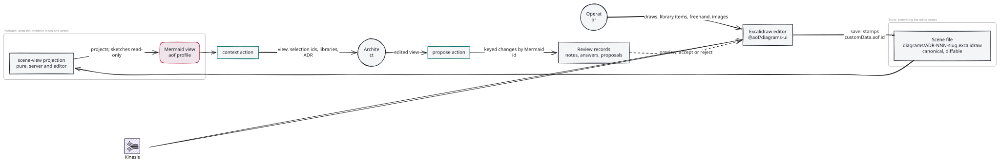

# 170 · Excalidraw phase 1 — Architecture Decisions

ADR-001 to ADR-004 record decisions delivered on the branch (measured, with their gates named).
ADR-010 to ADR-013 are the format the phase settled on — Excalidraw's scene is the store, Mermaid is
the interface — and supersede ADR-005 (a one-shot Mermaid import) and ADR-006–ADR-009 (the `.mmd` as
the store), both built and withdrawn on this branch; their records stay so the reversal is legible. Each honours 133's ADR-002
(the generator is one adapter, named once), ADR-003 (the layout has one home) and ADR-007 (a
diagram reaches the page as an image, never as markup), and 135's ADR-001 (a practice is its own
package, depended on one way).

## ADR-001: Diagramming is a package pair the build can leave out, depended on one way

**Status:** Accepted
**Date:** 2026-10-20

**Context.** Diagramming is a project in itself and will not be wanted on every client. Measured
on the branch: the Excalidraw SDK brought 188 packages (106 MB) into `node_modules` and took the
UI dist from about 1 MB to 22 MB, 13 MB of it fonts. The diagram verbs rode `@aof/work`'s
contribution, the generator adapter lived in core, the doctor lane in `@aof/work`, and the editor in
`apps/ui/src/board` — four homes for one concern, none of which a build could omit.

**Decision.** Two workspace packages. `@aof/diagrams` (node) holds the layout, the generator
registry and its one adapter, the five `diagram:*` verbs and the doctor lane, and exposes ONE
`{ name, commands }` contribution core registers. `@aof/diagrams-ui` (browser) holds the editor,
its pure state and the SDK, pinned, with React as a peer; it exposes `./editor`, `./editor-state`
and `./fonts` (the build-time seam that says where the SDK's fonts are, so the app never names
the SDK). Dependencies run one way: both depend on `@aof/work`; `@aof/work` imports nothing of
either and exports no diagram module. The work doctor takes the lane and the item listing probe by
injection (`diagramsGroup`, `diagramListing`, defaulting to null); core injects node's `readdir`.
The board reaches the editor through one dynamic `import("@aof/diagrams-ui/editor")`.

**Consequences.** FF-17001 (`acd-diagrams-package-one-way`) pins the direction. The board's chunk
is unchanged and the SDK stays in the lazy half (measured). The HTTP routes and the bundled
prompts stay in core until the contribution contract carries routes and assets (out of scope).

## ADR-002: One capability read is the opt-out seam, and the editor follows the generator switch

**Status:** Accepted
**Date:** 2026-10-20

**Context.** The board must know, before showing Edit draft, whether this project offers the
editor — and a client built without the package must get the same answer without a second code
path. `work.diagrams` has one reader (133/ADR-001 §3), so the answer may not read config itself.

**Decision.** `diagram:capability` (`aof diagram capability`) answers
`{ absent, enabled, editor, generator }` through the one reader; `editor` equals `enabled`, so a
project that has turned diagrams off has turned the editor off too (a draft editor that quietly
stayed on would be a second switch). The board face serves it as `GET /api/diagram/capability`; when
the registry has no such command the face answers the same shape with `absent: true`. The
ARCHITECTURE tab asks once per mount through an injected asker and shows Edit draft only when
`editor` is true; any failure is "not editable", never a retry.

**Consequences.** Tier one (off by config) is complete and verified in a real browser. Tier two
(package absent) is answered correctly by the face but cannot yet occur, because core imports the
package statically — the follow-up named in SPEC's out-of-scope.

## ADR-003: The editor is a routed surface, addressed by query, listed under no nav item

**Status:** Accepted
**Date:** 2026-10-20

**Context.** As a fullscreen occupant of the board the editor was not addressable (no deep link
from the architect's hand-back, nothing to refresh back into), never stacked (being replaced is
being dismissed, unsaved work and all), and hid the dock behind the canvas. The shell's nav derives
one item per addressable route and is designed for four.

**Decision.** A fifth row, `{ id: "diagram", path: "/diagram" }`, rendered `content:fixed`. The
surface's address vocabulary (`?ref=&file=`) is its own module, `apps/ui/src/diagram/
diagram-address.mjs`, which reads the path off the table and spells the query with
`URLSearchParams`; the route table keeps knowing no query key but `mode`. The nav lists the row
under no item through its own exported unlisted set, beside its labels — the nav's vocabulary, not
a column of an origin-blind table. The surface's dock is its own posture author
(`dock-mount.mjs`, a `local-pty` typed the review invocation), contributed to the shell's overlay
slot at the board-dock host. The board's Edit draft is a link built by the address module; the
board imports nothing else of the surface.

**Consequences.** The posture table gained the fourth row it was built to cost; the ninth UI
directory has its row; the route-literal detector covers `diagram`. The local-PTY mount builder is
now spelled twice (board, diagram) and the lift into `apps/ui/src/terminal/` is owed.

## ADR-004: A saved scene is a draft, and a proposal touches only what it names

**Status:** Accepted (PR #13, restated here so the import carries it)
**Date:** 2026-10-18

**Context.** The architect and the operator edit the same picture at different times. A whole-
scene write would discard whichever side moved last; a draft that published itself would make
Save an approval.

**Decision.** Save never rewrites ARCHITECTURE.md, the SVG or PNG, or work status. Review records
live beside the draft (`diagrams/<stem>.review/{requests,proposals}/`). A proposal is a minimal
list of add/update/delete element operations with a per-element base snapshot; accept merges only
the touched elements, refuses `diagram-proposal-stale` if any of them changed since, and leaves
every other operator edit in place. New elements carry `customData.aof` provenance.

**Consequences.** Accept writes the scene and then the proposal record, not atomically (a crash
between them leaves the proposal pending and a retry refused as stale). A stale lock is an
operator's to remove. Both are recorded, not hidden.

## ADR-005: A first draft comes from Mermaid the architect writes, converted in the editor, and lands as a proposal

**Status:** Superseded by ADR-006–ADR-009, then by ADR-010–ADR-013 (2026-10-21)
**Date:** 2026-10-20

**Context.** Nothing turned the generator's HTML/SVG into a native scene, so every diagram opened an
empty canvas. ADR-005 had the architect write Mermaid for a first draft only, converted in the
editor into Excalidraw elements stored in a separate `.excalidraw` scene.

**Decision (as built, then withdrawn).** A `draft` action stored Mermaid; the editor converted it
and accepted the result as element operations into the `.excalidraw` scene.

**Why it was superseded.** The operator's review found three representations of one diagram that
nothing kept in step: the published HTML/SVG, the Mermaid draft, and the Excalidraw scene, with
later changes made as element operations in a fourth vocabulary. Mermaid as the authoring language
was right; Mermaid as a one-shot import was not. ADR-006 makes it the format.

## ADR-006 – ADR-009: The `.mmd` as the one stored format (withdrawn)

**Status:** Superseded by ADR-010–ADR-013 (2026-10-21)
**Date:** 2026-10-21

**Decision (as built, then withdrawn).** The one stored artifact was `diagrams/ADR-NNN-<slug>.mmd`,
the aof Mermaid profile (ADR-006). The canvas was a view of it, re-drawn from the file by Excalidraw's
converter and saved back by rule — a place always, a size only when it differed from the label's, a
path only when bent; freehand, lines, images and loose text were refused by name (ADR-007). A proposal
was the whole diagram, merged three ways on accept by keyed fact (ADR-008). Publish exported the
figure from the canvas (ADR-009, carried forward unchanged as ADR-013).

**Why it was superseded.** The operator's next questions — "custom Excalidraw styling?", "templates,
e.g. Azure resources?" — had no answer in it. A Mermaid file stores only what Mermaid can say: an
icon from an `.excalidrawlib`, a person's freehand note, an image, a hand-placed label all had to be
refused or re-described in the profile. Re-describing a library item in the DSL means recreating the
library, which the operator ruled out. The store has to hold everything
the editor draws; only the architect's INTERFACE needs to be text. Mermaid stays — as that interface
(ADR-010), not the file.

## ADR-010: The diagram is Excalidraw's scene; the architect reads and writes it as Mermaid

**Status:** Accepted
**Date:** 2026-10-21

**Context.** Two readers want two things. The editor, and the person in it, want everything
Excalidraw draws — library items, freehand, images, styling — kept exactly. The architect wants a
language it writes well and can diff. A second hand-rolled DSL was considered and dropped: Mermaid is
already in the stack (the converter bundles it), models write it fluently, and GitHub renders it.

**Decision.** The stored file is Excalidraw's native scene, `diagrams/ADR-NNN-<slug>.excalidraw`,
written canonically (keys sorted, one element per line, `updated` stripped, appState cut to
background and grid) so a diff reads. The architect never sees it. `@aof/diagrams/scene-view`, pure
and loaded by both server and editor, PROJECTS the scene into the aof Mermaid profile
(`@aof/diagrams/mermaid-profile`, the canonical flowchart subset of ADR-006, extended only inside
`%%` comments):

| In the scene | In the Mermaid view |
| --- | --- |
| a rectangle, diamond or ellipse; its bound text | a node and its label (`["…"]`, `{"…"}`, `(("…"))`, `("…")` for rounded) |
| one insertion of a library item (all its elements, one outer group, tagged `customData.aof.lib`) | a node plus `%% aof:lib <id> <library>/"<item>"`; its label is the tagged caption, else the item name |
| a frame | a `subgraph`; its members are the nodes whose `frameId` names it |
| an arrow bound at both ends to nodes | an edge `<from> --> <to>` (six kinds), keyed `<from>-><to>#<n>`; its bound text is its label |
| anything else — freehand, lines, loose text, images, half-joined arrows | `%% aof:sketch <id> "
"`: read-only, never dropped |
| a node's position | `%% aof:node <id> x= y=` |

Mermaid ids live on the elements as `customData.aof.id`; save gives one (`n<k>`, `g<k>`, `s<k>`) to
whatever a person drew without one, and a copy carrying a claimed id becomes new. `context` answers
the view, the selection as Mermaid ids, the project's library item names, the brief and the ADR.
`propose` takes the edited view; omitted `aof:node` and `aof:lib` lines for nodes that remain mean
"unchanged", so the architect never repeats coordinates and never invents them. Notes, answers and
proposals stay review records beside the diagram, naming Mermaid ids.

**Consequences.** Nothing a person draws is refused, and the architect cannot damage what it cannot
express — a sketch is read-only to a proposal. The view is lossy by design (a node's size, an arrow's
bends and fonts are not in it), so a proposal can say what changes but not every pixel of how; ADR-012
owns that. Parallel edges are keyed by drawing order, so deleting the first of two re-keys the second.

### Diagram

Drawn in the editor this ADR describes, at 170's UAT: a first draft, recoloured to the house style,
with a project library item placed by hand and connected by the architect.

Source: [ADR-010-scene-is-the-store.excalidraw](diagrams/ADR-010-scene-is-the-store.excalidraw) · PNG: [ADR-010-scene-is-the-store.png](diagrams/ADR-010-scene-is-the-store.png)

## ADR-011: Project libraries are used as they are, and an inserted item keeps where it came from

**Status:** Accepted
**Date:** 2026-10-21

**Context.** Teams already have `.excalidrawlib` files (Azure, AWS, C4 icon sets). An item is several
loose elements — lines, paths, a rounded box — that only mean "Function App" together.

**Decision.** A project's libraries live in `.aof/diagrams/libraries/*.excalidrawlib`, read as they
are (v2 named items; v1 unnamed items are "item N"; 8 MB in all). The editor loads them into the SDK's
own Library panel through `libraryItemsFor`, which tags every element with
`customData.aof.lib = { library, item }` and gives a multi-element item one outer group. The SDK's
duplication deep-copies `customData`, so every insertion — by a person from the panel, or by aof from
a proposal — carries its provenance; one outer group is one node. The architect names items, never
draws them: `%% aof:lib <id> <library>/"<item>"` on a new node must resolve to exactly one item
(`diagram-library-unknown` otherwise). A node's item cannot be swapped in place — remove it and add
another.

**Consequences.** No library is recreated in any DSL. An aof insertion adds a transparent anchor box
(tagged `anchor`) that arrows bind to, and a caption (tagged `label`) centred under the item. A
library deleted after use leaves its insertions intact and named; only new insertions need it.

## ADR-012: A proposal is compiled in the editor and accepted element by element

**Status:** Accepted
**Date:** 2026-10-21

**Context.** The server holds no SDK — text measurement, the converter's layout and element defaults
are browser-side. A person may keep drawing while the architect works, so accept must keep their edits
and refuse precisely when they collide.

**Decision.** `propose` diffs the view it was made against with the edited view into keyed changes
(`node:`, `edge:`, `subgraph:`, `style:`, `layout:`, `lib:`) and snapshots the elements each change
touches — per kind: a style its node's elements and frames; a relabel or reshape those and its arrows
(a relabelled box may grow); a move those and its arrows; a removal those and the boxes at the far
ends; an edge its arrow and both boxes; a subgraph its frame and members. In the editor,
`@aof/diagrams-ui/compile` turns the changes into element edits — removals; frames; added nodes (a box
placed by the converter's hint aligned on a shared node, or a cloned library item); relabels (the box
grows about its centre to fit, the text is centred); shapes; styles; moves; edges drawn straight and
bound at both ends; arrows re-routed for moved or grown boxes with labels at the midpoint; frames
fitted — normalises them with the SDK's `restoreElements`, and sends the touched elements as `add` /
`update` operations. `accept` refuses `diagram-proposal-stale`, naming the Mermaid ids, if any
snapshot element changed since, and `diagram-proposal-invalid` for an operation outside the snapshot.
An empty scene takes the first-draft path: the whole proposal through Excalidraw's converter, frames
for subgraphs, fresh ids tagged with the Mermaid ids.

**Consequences.** A person's unrelated edits survive any accept (measured in the browser: their
library item and freehand stroke are untouched by a rename, a library node and an edge). The compile
is checked by the property that matters — the scene a proposal compiles to reads back, through the
projection, as the proposal. A grown box can crowd a close neighbour; nothing pushes shapes apart.
Additions are not limited to what the proposal names (the editor is the operator's own, same-origin
and loopback-only), and accept writes the scene, then the record, not atomically, as ADR-004 recorded.

## ADR-013: Publish exports the figure from the same canvas

**Status:** Accepted (ADR-009 carried forward)
**Date:** 2026-10-21

**Decision.** The editor's Publish saves, exports SVG and PNG with the SDK, and the `publish` action
writes the SVG — and the PNG when `work.diagrams.formats` owes one — where the ADR's block links,
under the diagram's lock and revision; it answers that block (source `.excalidraw`) for the architect,
the single writer of ARCHITECTURE.md, to paste. The board's diagram route alone accepts up to 16 MB;
every other board write keeps the 1 MB limit.

**Consequences.** The ADR's figure is the diagram, library items and sketches included. Export runs in
the browser; `aof diagram export` (the diagram-design path) is untouched, and a CLI-only export of a
scene would need a headless browser.
