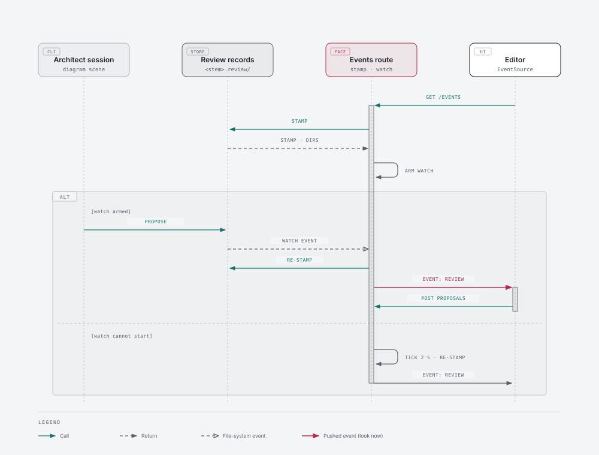

# 171 · Excalidraw phase 2 — Architecture Decisions

Phase 2 builds on milestone 170's editor without changing its store: the diagram is still
Excalidraw's scene, the architect still reads and writes it as Mermaid (m170/ADR-010), and a note,
an answer and a proposal are still review records beside the diagram (m170/ADR-004). Every decision
here keeps three of 170's rules: the board face invokes `diagram:*` by command id and imports nothing
of `@aof/diagrams` (m170/ADR-001), a diagram path is built only in `layout.mjs` (FF-13302), and an
artifact has one home with everything else derived from it (170 RETROSPECTIVE R5, recall
`7f16ede5-82e1-40bc-bab0-de5e4f3af603`).

## ADR-001: On-canvas affordances are one overlay, positioned through one anchor module

**Status:** Accepted
**Date:** 2026-10-24

**Context.** F-170-11: a note can be added only from the bar below the canvas. Phase 2 also wants a
note's thread read beside the shape it names (ADR-006). Excalidraw 0.18 offers no API for custom
context-menu items, no selection toolbar slot and no comments (measured in
`@excalidraw/excalidraw/dist/types/excalidraw/types.d.ts`: `renderTopRightUI`, `children`,
`onScrollChange` and `onChange` are the extension points). It does export
`sceneCoordsToViewportCoords` and `getCommonBounds`.

**Decision.** The editor draws ONE overlay layer above the canvas, as a child of the SDK component.
Everything aof puts on the canvas lives in it: the "Ask architect" action at the current selection
(story 00 — the operator ruled at refine, 171/00 Q1, that the canvas offers Ask architect and notes
are added through the editor's bar) and the note pins and thread popovers (ADR-006). Where a thing sits is computed
in one pure module, `@aof/diagrams-ui/canvas-anchor`: element bounds and the app state's
`scrollX`/`scrollY`/`zoom` and canvas offsets in, a viewport rectangle out, kept on screen at the
canvas edges. The overlay re-positions on `onScrollChange` and `onChange`. A question asked at
the selection goes through the editor's one ask path (`recordRequest`, then the launch the bar's
Ask architect uses), with the selection the bar would have sent, so a canvas ask and a bar ask are
the same record and the same session.

**Alternatives considered.**
- Patching the SDK's context menu — the SDK is pinned (m170/ADR-001) and exposes no item API; a
  patched dependency is a fork to maintain. Rejected.
- A keyboard shortcut only — invisible to a person who does not know it. It may sit beside the
  action, never replace it.

**Consequences.** Each on-canvas affordance is a component of the overlay, never a second
positioning scheme. A shape scrolled off-screen hides its affordances. Positioning is testable
headlessly; the look is verified by reading screenshots (170 RETROSPECTIVE R1, R6, R8).

**Invariant.** Only `canvas-anchor.mjs` converts scene coordinates to viewport coordinates in
`packages/diagrams-ui/src` (FF-17102).

## ADR-002: Library search is aof's own tab in the SDK's sidebar, inserting through the SDK's own library drop

**Status:** Accepted
**Date:** 2026-10-24

**Context.** F-170-12: with a real set (249 AWS icons) an item can only be found by scrolling; the
SDK's only search box searches the canvas. The editor already holds every library item from both
roots (m170/ADR-011 as amended at its verify), tagged with provenance by `libraryItemsFor`.

**Decision.** A "Find" tab is added to the SDK's `DefaultSidebar` beside its Library tab
(`DefaultSidebar.TabTriggers` / `Sidebar.Tab`). It filters the items the editor already loaded, by
item name or library name, case-insensitively, ranked in one pure module
(`@aof/diagrams-ui/library-search`). A result is inserted the way a Library-panel item is: dragged
with the SDK's own library MIME type (`application/vnd.excalidrawlib+json`), or clicked to drop at
the viewport's centre. Both carry the elements `libraryItemsFor` produced, so every insertion keeps
`customData.aof.lib` exactly as a panel insertion does.

**Alternatives considered.**
- Filtering the Library panel itself with `updateLibrary` — it replaces the panel's contents, and
  would drop items a person added from the canvas. Rejected.
- A server-side search action — the items are already in the browser, and a few hundred names do not
  need an index. Rejected.

**Consequences.** One insertion path, one provenance tag. Previews are rendered lazily, a page of
results at a time, so a large set costs nothing until searched.

## ADR-003: Review records are pushed as one "look now" event stream per open diagram

**Status:** Accepted
**Date:** 2026-10-24

**Context.** F-170-13: when the architect finishes, the open editor does not update by itself. The
editor polls `proposals` every five seconds; the architect writes records from a different process
(`aof diagram scene … --action respond|propose`), so there is no in-process event to forward. The
board has no push channel today (its other surfaces poll). 167/ADR-009 already watches work trees
with a recursive `fs.watch`, a safety re-walk and a degrade path.

**Decision.**
1. **The stream.** `GET /api/diagram/events?ref=&file=` on the board face answers
   `text/event-stream`, no-store. An event says only WHAT moved — `review` or `scene` — with the
   stamp that moved. It never carries records: the editor re-reads through the actions it already
   uses (`proposals`, `read`), so the records keep one reader.
2. **Change detection without a diagram path in the face.** A new `diagram:scene` action, `stamp`,
   answers `{ scene, review, watch }`: the scene file's and the review records' identities by stat
   (name, size, mtime — the F-170-05 cache key), and the directories that hold them, built in
   `layout.mjs`. The face invokes `stamp` once when a client connects, arms a generic recursive watch
   on the `watch` directories, re-stamps on a watch event (debounced) and every 30 s as a safety, and
   ticks every 2 s instead when a watch cannot start — 167/ADR-009's pattern. A changed stamp is one
   event. A comment line every 25 s keeps the connection open. The watch closes with the connection.
3. **The editor.** It subscribes with `EventSource` while open and visible. On `review` it refreshes
   the panel; on `scene` it re-reads the draft: a clean canvas is replaced in place and says so; a
   canvas with unsaved edits is kept, says the saved draft changed, and offers a reload. While the
   stream is down the five-second poll runs, and stops when the stream is back.

**Alternatives considered.**
- A WebSocket route — the terminal's upgrade route serves PTYs only, and nothing here needs a
  browser-to-server message. Rejected.
- A faster poll — load for every open editor, still not immediate. Rejected.
- Having the face watch a path it builds itself — a diagram path outside `layout.mjs` (FF-13302) and
  a face that knows the store. Rejected.

**Consequences.** The face still imports nothing of `@aof/diagrams` (FF-17101). A server without the
package answers 404 for the stream, and the editor stays on its poll, as it does on a stream error.
Watches on network or WSL-mounted paths may miss events; the 30 s safety bounds that.

**Invariant.** The board face's diagram routes, the stream included, import nothing of
`@aof/diagrams` and invoke only `diagram:*` command ids (FF-17101).

### Diagram

The stream has four moving parts in two processes, and the order matters (stamp, watch, re-stamp,
event, re-read). View: a sequence across the architect's CLI, the review store, the board face and
the editor. Components: the architect session (`aof diagram scene --action propose`), the
`diagrams/<stem>.review/` store, the face's events route with its watch, and the editor. Flows: the
architect writes a record; the watch fires; the face re-stamps; a `review` event reaches the editor;
the editor re-reads `proposals`. Then a second lane for a fallback: the watch cannot start, so the
face ticks.

Source: [ADR-003-push-stream.html](diagrams/ADR-003-push-stream.html) · PNG: [ADR-003-push-stream.png](diagrams/ADR-003-push-stream.png)

## ADR-004: The house style is read from the style guide, filled in by propose, and is the canvas's default

**Status:** Accepted
**Date:** 2026-10-24

**Context.** At 170's UAT a first draft came out uncoloured until a note asked for the house style.
`work.diagrams.style` names a style guide in the diagram skill's structure; its "Semantic roles"
table gives each role (`paper`, `paper-2`, `ink`, `muted`, `accent`, `accent-tint`, `link`) a light
value. The operator ruled on 2026-10-24 that shapes drawn by hand also start in the house style.

**Decision.** One pure module, `@aof/diagrams/house-style`, reads the semantic-roles table into a
palette. Nothing copies the palette into config: the style guide is the one source (R5). Then:
- `context` carries the palette, so the architect picks an emphasis role (`link`, `accent`) by name.
- `propose` fills `style <id> fill:<paper>,stroke:<ink>,color:<ink>` for every node the proposal ADDS
  that names no style of its own and is not a library item. The fill-in is in the proposal's stored
  text and its changes, so Preview and the record say what will be drawn. A first draft is a proposal
  that adds every node, so it is covered by the same rule.
- `read` carries the palette, and the editor sets the canvas's defaults for a new shape from it
  (stroke `ink`, background `paper`, solid fill).
- With no style configured, or no readable table, the palette is null: nothing is filled, and
  Excalidraw's defaults hold.

**Alternatives considered.**
- Telling the architect in the prompt to colour every node — what it forgets is uncoloured, and the
  operator would have to notice. Kept as guidance for emphasis only.
- Colouring at accept in the editor — the stored proposal would not say what will be drawn. Rejected.

**Consequences.** A library item is never recoloured. A person can still change any shape's colours.

## ADR-005: A note lands in an open architect session by being typed into it

**Status:** Superseded by m172/ADR-003 (2026-10-28) — the conversation is a headless session on the board's server (m172/ADR-001), its answer streams into the thread (m172/ADR-002), and the dock and its typed delivery leave the diagram surface (172/03).
**Date:** 2026-10-24

**Context.** PRD phase 2: a note typed while the architect session is open should reach it as it is
written. Today a note waits for a batch review, and a second Ask architect is never typed at all: the
dock's command is typed once per session, the session's identity does not include the command, so a
new command on the same dock changes nothing (`apps/ui/src/terminal/TerminalControl.tsx`,
`sendCommand`).

**Decision.** The diagram surface owns delivery, in one function: when its dock is open and its
socket is open, the invocation for a new note (`/aof:diagram-review <ref> <file> <id>`) is typed into
that session as further input; otherwise the note waits, and Ask architect starts a session as it
does today. `TerminalControl` gains ONE seam for this: an optional later input, typed once per
sequence number on the same raw path a keystroke takes, only while input is enabled; the once-per-
sequence rule lives in a pure module beside the control. Claude Code queues input typed while it
works, so a note sent mid-answer is taken next.

**Alternatives considered.**
- Re-spawning the session for every note — loses the conversation and costs a cold start. Rejected.
- The server writing into the PTY — no HTTP path reaches a PTY today, and the browser already holds
  the socket. Rejected.

**Consequences.** Ask architect on an open dock types into it instead of doing nothing. A note sent
while no session is live stays a note, as in 170.

## ADR-006: A note is a thread on its request record, read beside the shape it names

**Status:** Accepted
**Date:** 2026-10-24

**Context.** A request record holds one `request` and one `answer`. A conversation about a shape
needs follow-ups both ways.

**Decision.** A request record gains `thread`: turns `{ by: "operator" | "architect", text, at }`.
A new `reply` action appends an operator turn and reopens the note; `respond` appends an architect
turn and keeps setting `answer` to the latest architect turn, so every existing reader (the panel,
the batch review, `context`) keeps working. A record written before this has the thread its
`request` and `answer` imply. `context` carries the thread. The overlay (ADR-001) pins each note to
the shape its selection names; a whole-diagram note stays in the review panel. A reply is delivered
by ADR-005's function.

**Alternatives considered.** A separate thread file per note — a second artifact to keep in step with
the request (R5). Rejected.

**Consequences.** A thread is bounded by the record's existing size limit
(`diagram-review-too-large`). A note whose shape is deleted shows in the panel only.

## Fitness functions

| id | invariant | enforced by (arch-test) | from |
|---|---|---|---|
| FF-17101 | The board face's diagram routes, the events stream included, import nothing of `@aof/diagrams` and invoke only `diagram:*` command ids. | `test/arch/diagrams/acd-diagram-face-imports-nothing.test.mjs` (story 02) | ADR-003 |
| FF-17102 | Only `canvas-anchor.mjs` converts scene coordinates to viewport coordinates in `packages/diagrams-ui/src`. | `test/arch/diagrams/acd-diagram-canvas-anchor-one-home.test.mjs` (story 00) | ADR-001 |
