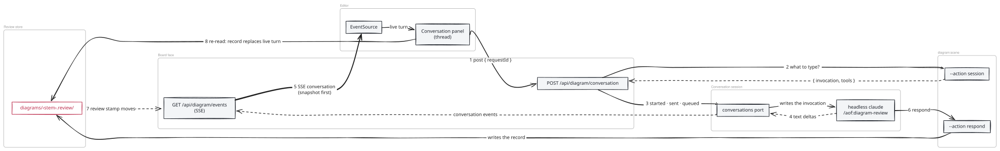

# 172 · Excalidraw phase 3 — Architecture Decisions

Phase 3 keeps the diagram editor's store and every record 171 introduced: a note is still a thread on
its request record (m171/ADR-006), the architect still answers with `respond` and changes the diagram
with `propose`, and the review records are still the thread's one home (170 RETROSPECTIVE R5). What
changes is where the conversation runs and where it is read. The architect's session leaves the
terminal dock and runs headless on the board's own server (ADR-001); its answer reaches the editor as
it is written, over the diagram's one events stream (ADR-002); and the editor reads every conversation
in one panel beside the canvas (ADR-003).

Three rules carry over unchanged: the board face invokes `diagram:*` by command id and imports
nothing of `@aof/diagrams` (FF-17101, now covering the conversation route too), only `canvas-anchor.mjs`
places anything on the canvas (FF-17102), and diagramming is its own package depended on one way
(FF-17001).

The architect recall for these decisions (`aof work memory recall … --area architecture`, recall id
`3f0c9a6e-2b7d-4f55-9b1e-6c2a8d04e1a7`) surfaced five ADRs: m171/ADR-005 is consciously departed from
(ADR-001 below supersedes it), m171/ADR-003 and m170/ADR-003 are honoured (the stream stays one per open
diagram, and the editor stays a routed surface), m170/ADR-005 is honoured (a first draft is still a
proposal), and m170/ADR-013 does not bear on this milestone.

## ADR-001: The architect's conversation is one headless `claude` session per open diagram, owned by the board's server

**Status:** Accepted
**Date:** 2026-10-27

**Context.** F-171-04: every question opens, or types into, a visible terminal dock, and the operator
judged that unfit. The dock exists because the architect's session was an interactive `claude` in a
PTY — the only way a browser could reach it was to type into its terminal (m171/ADR-005). RESEARCH Q1
measured the alternative on this machine: `claude -p --input-format stream-json --output-format
stream-json --include-partial-messages` holds ONE session across turns written to its stdin, streams
each answer as text deltas, runs allowed tools in the turn, and runs on the subscription login. The
loop's driver retired print mode for a reason that does not hold here (m38/ADR-013: a print-mode turn
cannot pause to ask a human — but in this conversation the human's turns ARE the input).

**Decision.**
1. **A generic conversation session in `@aof/execution`.** One module,
   `packages/execution/src/conversation-session.mjs`, owns a headless `claude` conversation: it
   spawns the process with an argument vector (never a shell) through the provider seam's resolution
   of `claude`, writes each delivery as one stream-json user message, and reads stdout through one
   pure reader in the same module that turns stream-json lines into conversation events (`session`,
   `turn`, `text`, `activity`, `turn-end`). It knows nothing of diagrams: what to type, which tools to
   allow and where to run are its caller's.
2. **One session per key, one turn at a time.** Sessions are keyed (the board keys them by item ref
   and diagram file). The first delivery for a key starts its session; a delivery while a turn is in
   flight is queued in the module, in order, and written when the turn's `result` line arrives. Each
   turn carries the delivery's `requestId` (null for a batch review), so every event names the note
   it answers.
3. **The launch.** `--permission-prompts none` and an explicit `--allowedTools` list (the caller's),
   so anything outside the list is denied in the turn rather than waiting on a prompt nobody can see;
   never `--dangerously-skip-permissions` or `bypassPermissions` (FF-17201). The model and effort are
   the refine phase's session launch (`session-model.mjs`), the phase the architect works in. The
   environment is the server's minus the session-attachment keys — the one predicate the loop's
   driver already scrubs with (`isSessionAttachmentKey`, module-private in `session-driver.mjs`
   today), hoisted into `session-model.mjs`, the pure launch leaf both spawns read, so the two
   launches of `claude` never disagree on what a child must not inherit. The working directory is the
   project root.
4. **The end.** A session is ended ten minutes after its last subscriber left (the operator, 172/00 Q1, 2026-10-27) with no turn in
   flight, when the server closes, or when the process exits on its own. Ending closes stdin and then
   terminates the process tree. An `ended` event names the reason; a queued delivery is not retried —
   its note is a record and stays open for the next ask or batch review. A session that ends does not
   resume the old conversation: the next delivery starts a fresh one, and the `context` action already
   hands it the note's whole thread. A server that dies without closing leaves no long-lived orphan:
   the child's stdin pipe closes with its parent, and a stream-json session exits at end of input.
5. **Composition.** Core's board binding (`packages/core/src/application/bindings/board-ui.mjs`)
   constructs the conversations and hands them to the board face as a `conversations` port, beside
   `watchDirectory` and `reportDegrade`; the server transport spawns nothing itself. One test seam:
   the binding launches the executable named by `AOF_ARCHITECT_EXECUTABLE` instead of the resolved
   `claude` when it is set (a `.mjs` path runs under the server's own node), so a browser check stands
   in a scripted session that speaks stream-json. Nothing else reads it.

**Alternatives considered.**
- **Keep the interactive PTY, hidden, and tail its transcript.** Claude Code writes a transcript line
  per completed message, not per token, so the answer would land whole; and a permission prompt in a
  terminal nobody sees would hang the session silently. Rejected.
- **The Agent SDK.** It is the same CLI behind a library, and m38/ADR-013 records it forcing
  per-token API billing; `claude` stays CLI-on-subscription. Rejected.
- **A session per question.** A cold start costs ~18 s before the first token (RESEARCH Q1), and the
  conversation's context would be rebuilt every turn. Rejected; one session per open diagram.
- **Approving tools from the editor (`--permission-prompts host` and the stdio control protocol).**
  The protocol is the SDK host's and undocumented for direct use; the review needs a known, small tool
  set. Kept as a later option if a review ever needs a tool the list does not grant.

**Consequences.** The board's server holds child processes for as long as a diagram is open and
for ten minutes after. A denied tool is reported in the turn (`turn-end` carries the denials) and the
architect answers without it. The loop's driver and the terminal dock are untouched; a project can
still run `/aof:diagram-review` from any Claude session, as in 170.

**Invariant.** The conversation launch never bypasses permissions and never spawns through a shell
(FF-17201).

## ADR-002: The live turn rides the diagram's one events stream, and the record stays the thread's one home

**Status:** Accepted
**Date:** 2026-10-27

**Context.** m171/ADR-003 made one "look now" stream per open diagram: an event says what moved, and
the editor re-reads the records through `proposals` and `read`. A streamed answer is different in
kind — it is text that exists only while it is being written — but it belongs to the same open
diagram, and a second stream per editor is a second connection, a second reconnect rule and a second
place the board watches the same thing (extend the surface, never add a sibling).

**Decision.**
1. **Delivery.** `POST /api/diagram/conversation?ref=&file=`, admitted as every board write is
   (`admitWriteRequest`), with body `{ requestId }` (or `{}` for a batch review of every open note).
   The face invokes `diagram:scene --action session`, which answers what to type and which tools to
   allow — `{ invocation, tools }` — refusing a request id the diagram does not hold. The face hands
   that, keyed by ref and file, with the project root as the working directory, to the
   `conversations` port, and answers `{ outcome: "started" | "sent" | "queued" }`. With no port, or
   no `claude` to launch, it answers 503 `architect-session-unavailable` with the reason.
2. **One home for the architect's vocabulary.** The `/aof:diagram-review` invocation and the
   session's tool list are spelled in ONE module, `packages/diagrams/src/review-session.mjs`, which the
   `session` action and the editor's copy-the-command fallback both import (FF-17202). The tool list is
   the command's own needs: `Read`, `Grep`, `Glob`, `Write` and `Bash(aof diagram scene:*)`.
3. **The stream carries the live turn.** `/api/diagram/events` subscribes the port for its diagram
   while the editor is connected and forwards each conversation event as an SSE `conversation` event.
   The first event of a connection is a `conversation` snapshot — the session's state and the turn in
   flight with the text so far — so an editor that connects mid-answer catches up. The subscription
   closes with the connection, and its departure starts ADR-001's idle clock when it was the last.
4. **The record replaces the live turn.** Streamed text is never stored. The architect still records
   its answer with `respond` (or a proposal with `propose`); that write moves the review stamp, the
   editor re-reads the records, and the recorded turn takes the live turn's place in the thread. The
   `diagram-review` command gains one instruction for a conversation: write the answer as the turn's
   final text, then record that same text with `respond` — so what streamed and what is kept read the
   same.

**Alternatives considered.**
- **A second SSE route for the conversation.** Two connections per editor, two reconnect rules.
  Rejected.
- **Recording the streamed text as the answer, server-side, from the turn's `result`.** A second
  writer of the thread beside `respond`, and a proposal turn has no single answer text. Rejected.
- **The browser building the invocation and posting it.** The server would type whatever a page
  sent into a session that runs Bash. Rejected: the server derives it from a request id it holds.

**Consequences.** The face still imports nothing of `@aof/diagrams` and invokes only `diagram:*`
ids (FF-17101 extends to the conversation route). An editor on a server without the port shows the
command to copy, as in 170. Two editors on one diagram see one session and the same live turn.

**Invariant.** The `/aof:diagram-review` invocation and the architect session's tools are spelled
only in `review-session.mjs` (FF-17202).

### Diagram

The delivery and the stream cross two processes and a queue, and the order is the design: the post,
the session action, the port starting or queueing, the deltas forwarded on the stream, the respond
write, then the record replacing the live turn. View: a sequence across the editor, the board face,
the `diagram:scene` command, the conversation session and the review store. Components: the editor
(its panel and its EventSource), the face's conversation and events routes, `diagram:scene --action
session`, the `conversations` port with its headless `claude`, and `diagrams/<stem>.review/`. Flows:
the editor posts a request id; the face asks the scene command what to type; the port writes it to
the session; text deltas return over the events stream into the thread; the architect runs `respond`;
the review stamp moves; the editor re-reads and the recorded turn replaces the live one.

Source: [ADR-002-conversation-stream.html](diagrams/ADR-002-conversation-stream.html) · PNG: [ADR-002-conversation-stream.png](diagrams/ADR-002-conversation-stream.png)

## ADR-003: The editor's conversation surfaces are one panel beside the canvas; the dock leaves the diagram surface

**Status:** Accepted
**Date:** 2026-10-27

**Context.** The editor grew its conversation surfaces one milestone at a time: a review panel and a
note bar under the canvas (170), a thread popover beside each shape and a terminal dock under all of
it (171). A streamed answer can run to paragraphs, which a 320 px popover over the drawing cannot
hold without covering what it is about, and the column of header, notice, canvas, panel, bar and
dock leaves the canvas the smallest thing on the page. 171's OUTCOME records the gap: no committed
mocks, and replies' home an open assumption.

**Decision.**
1. **One panel.** The editor body is the canvas and, to its right, one conversation panel
   (`ConversationPanel.tsx`, DESIGN "The conversation panel"): every thread, the live turn, the
   proposals, and the composer that asks or saves a note. The review panel and the note bar under the
   canvas, and the thread popover beside a shape, are retired into it. At 768 the panel is a drawer
   over the canvas's right edge.
2. **Threads are read from the records in one pure model.** `conversation-model.mjs` turns the review
   records (and the scene, for each thread's subject) into threads — one per note, grouped by the
   shapes it names, a whole-diagram note under "Whole diagram" — with each thread's state and the
   proposal that answers it. The live turn from ADR-002 is merged in by a second pure reducer
   (`conversation-stream.mjs`), so the panel draws the model and computes nothing.
3. **The canvas keeps its two affordances, on the one overlay.** A note's pin stays on its shape's
   corner and the Ask architect action stays at the selection (m171/ADR-001, FF-17102); choosing a pin
   opens its thread in the panel, and asking at the selection opens the new thread there.
4. **The dock leaves the diagram surface.** `DiagramSurface.tsx` renders no terminal, and
   `TerminalControl`'s later-input seam (m171/ADR-005), whose only consumer it was, is removed with
   its rule in `input-policy.mjs`.

**Alternatives considered.**
- **Keep the popover beside the shape and stream into it.** It covers the shapes near the one asked
  about, and a long answer scrolls inside a box half the canvas high. Rejected: the operator chose the panel
  at refine (172/01 Q1, 2026-10-27).
- **Keep the dock as an option.** A visible terminal is exactly what F-171-04 rejects; the session
  is still reachable from any Claude session with the command. Rejected.

**Consequences.** Supersedes m171/ADR-005 (delivery by typing into the dock) and the "beside the
shape" placement in m171/ADR-006; the thread record of m171/ADR-006 is unchanged. The panel is the
one place a thread is read or replied to.

## Fitness functions

| id | invariant | enforced by (arch-test) | from |
|---|---|---|---|
| FF-17201 | The architect's conversation launch never bypasses permissions: its argument vector carries `--permission-prompts none` and an explicit `--allowedTools`, never `--dangerously-skip-permissions`, `--allow-dangerously-skip-permissions` or `bypassPermissions`, and it is spawned with an argument vector, never through a shell. | `test/arch/diagrams/acd-architect-session-never-bypasses-permissions.test.mjs` | ADR-001 |
| FF-17202 | The `/aof:diagram-review` invocation and the architect session's tool list are spelled only in `packages/diagrams/src/review-session.mjs`. | `test/arch/diagrams/acd-diagram-review-session-one-home.test.mjs` | ADR-002 |
